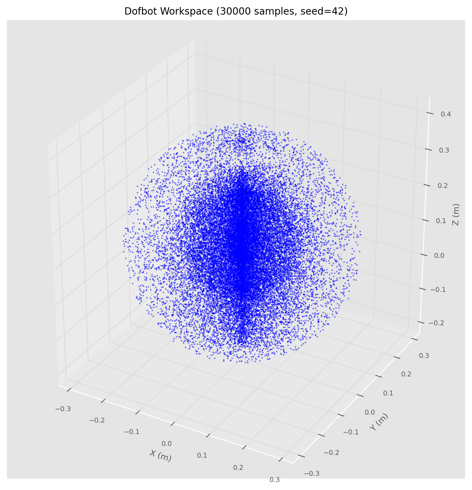
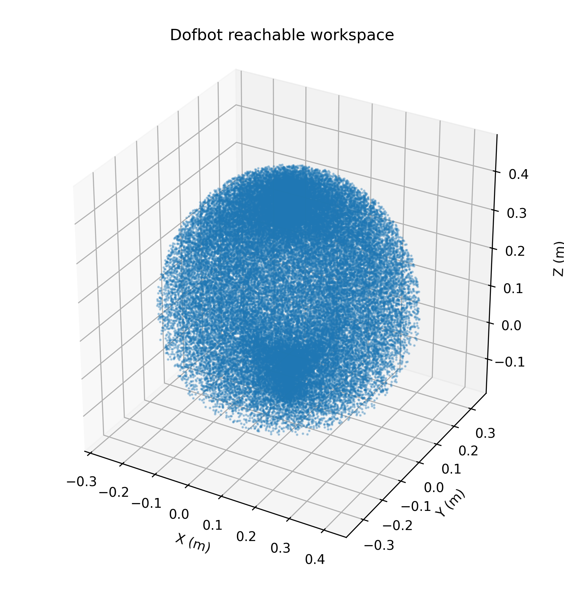
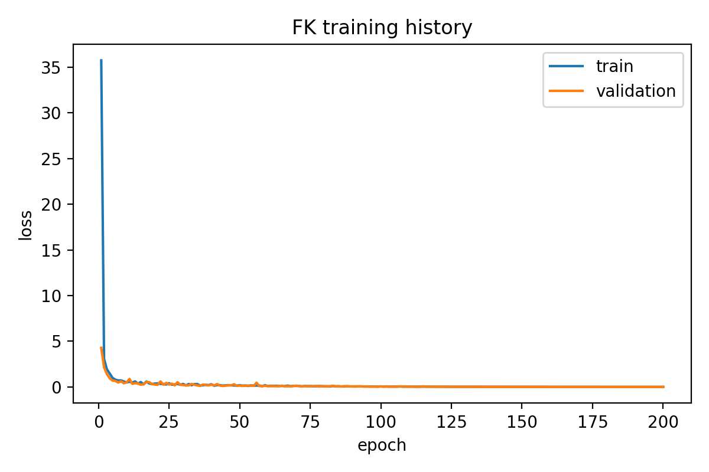
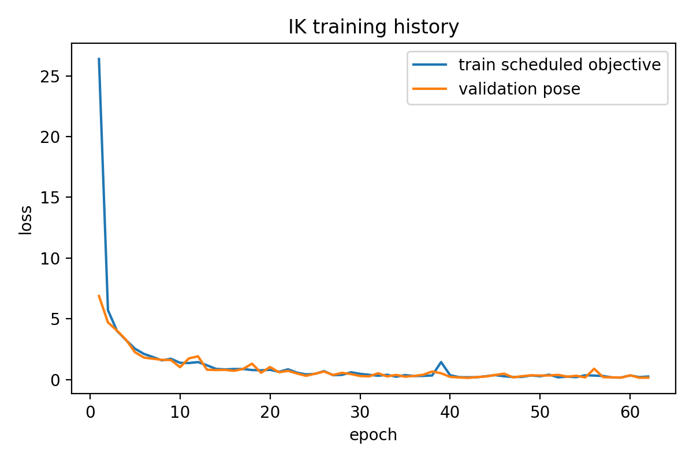
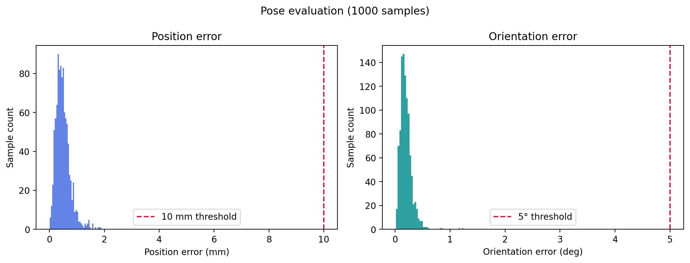
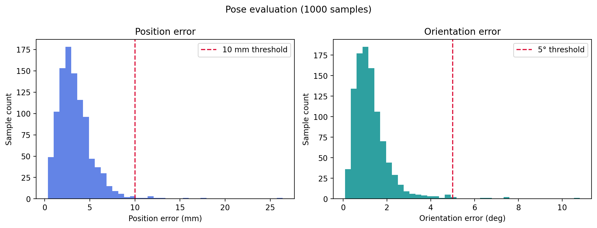
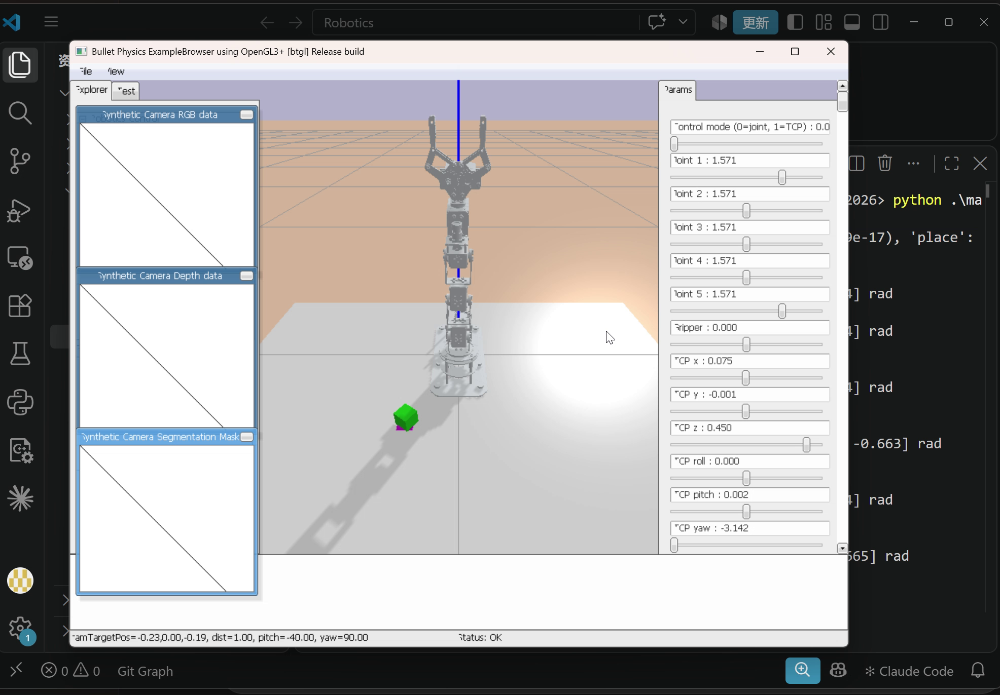

# Dofbot 机械臂运动学建模、学习与抓放仿真实验报告

> 课程大作业：Dofbot 第一次大作业（任务 0—7）  
> 实验日期：2026 年 10 月 14 日  
> 长度单位：m（误差另用 mm）；角度单位：rad（姿态误差另用 °）  
> 实验平台：Python、Robotics Toolbox for Python、PyBullet、NumPy、Matplotlib、PyTorch

## 1. 实验目标与结果概览

本实验以五转动关节 Dofbot 为对象，依次完成改进 DH 建模、正逆运动学、工作空间采样、数据预处理、数据驱动 FK/IK 训练、位姿误差评估和物块抓取放置。任务 0—3 使用改进 DH 模型及 Robotics Toolbox for Python；任务 4—6 使用 PyBullet 中的 URDF 固定 `tool_center` 坐标系采集和评估数据；任务 7 使用 PyBullet 动力学仿真。两套结果的末端坐标系和模型实现不同，本文分别说明其测量对象。

| 环节 | 主要结果 |
| --- | --- |
| 改进 DH 零位 | 五关节模型的末端位置为 $(0,0,0.39862)$ m，旋转矩阵为 $I_3$。 |
| 逆运动学 | 3 个正式目标的求解器均返回成功，FK 复算位置残差依次为 0.997674、0.459553、0.714040 mm；其中第 1、3 组解超出物理关节限位。 |
| 工作空间 | 在关节限位内独立均匀采样 30,000 组，获得 30,000 个 DH 末端位置点。 |
| 学习模型 | 60,000 条原始数据；FK 训练 200 轮，IK 训练 62 轮并提前停止。 |
| 独立测试 | 1,000 个样本；FK 联合成功率 100%，IK 联合成功率 98.7%，判据为位置误差不超过 10 mm 且姿态误差不超过 5°。 |
| 抓放仿真 | 成功抓起、搬运并稳定放置物块；最终物块中心与目标中心距离为 3.79 mm。 |

实验要求以[课程说明文件](../../2026dofbot第1、2次大作业介绍%2816：9%29%20v1.pdf)为准。下文的数据来自保存的程序输出、训练摘要、评估文件及成功仿真日志；图像和视频均引用本项目已有结果。

## 2. 任务 0：坐标系建立与改进 DH 模型

### 2.1 建系方法与参数含义

以底座最下方建立基坐标系 $\{0\}$，$z_0$ 沿第 1 转动关节轴；各后续 $z$ 轴沿相应转动关节轴，$x$ 轴沿相邻 $z$ 轴的公法线，$y$ 轴按右手定则确定。末端 $\{5\}$ 建在模型夹爪末端最上方。各关节的数学零位由程序中的 $q_i=0$ 定义，**不等同于 PyBullet 的复位姿态**。

采用改进 DH 约定：

$$
{}^{i-1}T_i=R_x(\alpha_{i-1})T_x(a_{i-1})R_z(\theta_i)T_z(d_i),
\qquad \theta_i=q_i+\mathrm{offset}_i.
$$

图示中的四个几何尺寸全部进入模型：$L_1=104.50$ mm、$L_2=82.85$ mm、$L_3=82.85$ mm、$L_4=128.42$ mm。$L_1$ 和 $L_4$ 分别写入沿关节轴的 $d_1,d_5$；$L_2,L_3$ 分别写入相邻轴间的 $a_2,a_3$。J2、J4 的固定角偏置对齐所选坐标系与关节零位；J2、J5 的扭转角描述相邻关节轴方向的变化。

| 关节 | 类型 | $a_{i-1}$ / m | $\alpha_{i-1}$ / rad | $d_i$ / m | $\mathrm{offset}_i$ / rad | 实际 $\theta_i$ |
| --- | --- | ---: | ---: | ---: | ---: | --- |
| J1 | R | 0 | 0 | 0.10450 | 0 | $q_1$ |
| J2 | R | 0 | $-\pi/2$ | 0 | $-\pi/2$ | $q_2-\pi/2$ |
| J3 | R | 0.08285 | 0 | 0 | 0 | $q_3$ |
| J4 | R | 0.08285 | 0 | 0 | $+\pi/2$ | $q_4+\pi/2$ |
| J5 | R | 0 | $+\pi/2$ | 0.12842 | 0 | $q_5$ |

使用 `RevoluteMDH` 顺序串接五个关节，得到 5R 模型。对 $q=[0,0,0,0,0]^\mathsf T$ 做正运动学复算：

$$
{}^0T_5(0)=
\begin{bmatrix}
1&0&0&0\\
0&1&0&0\\
0&0&1&0.39862\\
0&0&0&1
\end{bmatrix},\qquad
0.39862=0.10450+0.08285+0.08285+0.12842.
$$

这项长度和零位结果相符，说明四个给定尺寸均已参与计算。代码中的 `DH_demo` 是另一个 4 关节 RRPR 教学示例，其零位平移为 $(0.16570,0,-0.02392)$ m；它**不是**本实验的五关节 Dofbot 模型，也不用于后续 Dofbot 计算。


*图 1　Dofbot 五关节模型在数学零位的 Robotics Toolbox 姿态。*[4 关节教学示例图](./figures/Robotics_Toolbox_for_Python_%28Task0_1%29.png)另存供核对。

## 3. 任务 1：给定关节角的正运动学

按 ${}^0T_5(q)=\prod_{i=1}^{5}{}^{i-1}T_i$ 计算基座到 DH 末端坐标系的齐次变换。下列矩阵按程序输出保留六位小数；极小浮点量记作 0。$T$ 的右上角三维为末端位置，左上角 $3\times3$ 为末端旋转矩阵。

### 3.1 Demo

$q=[0,\pi/3,\pi/4,\pi/5,0]$：

```text
[-0.777146   0         0.629320   0.232594]
[ 0          1         0          0       ]
[-0.629320   0        -0.777146   0.024681]
[ 0          0         0          1       ]
```


### 3.2 第 1 题

$q=[\pi/2,\pi/5,\pi/5,\pi/5,\pi]$：

```text
[0         1         0         0       ]
[0.309017  0         0.951057  0.249628]
[0.951057  0        -0.309017  0.157445]
[0         0         0         1       ]
```


### 3.3 第 2 题

$q=[\pi/3,\pi/4,-\pi/3,-\pi/4,\pi/2]$：

```text
[-0.866025  -0.250000  -0.433013  -0.037037]
[ 0.500000  -0.433013  -0.750000  -0.064150]
[ 0         -0.866025   0.500000   0.307321]
[ 0          0          0          1       ]
```


### 3.4 第 3 题

$q=[-\pi/2,\pi/3,-2\pi/3,\pi/3,\pi/3]$：

```text
[ 0.866025   0.500000   0   0      ]
[-0.500000   0.866025   0   0      ]
[ 0          0          1   0.315770]
[ 0          0          0   1      ]
```


四组矩阵和平移方向与对应姿态图一致。第 2 题的 $q_4=-\pi/4<-0.16$ rad，第 3 题的 $q_3=-2\pi/3<-1.05$ rad，超出项目的物理关节限位。这两组是题目指定的**数学正解**示例，不应直接当作可执行的实机指令。

## 4. 任务 2：目标位姿的逆运动学

三组正式目标使用 `ik_LM`，共同初值 $q_0=[0,\pi/2,\pi/2,\pi/2,\pi/2]$。对返回的关节解再以同一改进 DH 模型做 FK。定义矩阵残差 $\Delta T=T_{\mathrm{FK}}-T_{\mathrm{target}}$；位置残差 $e_p=1000\|\Delta T_{1:3,4}\|_2$，旋转矩阵残差 $e_R=\|\Delta T_{1:3,1:3}\|_F$，整矩阵残差 $e_T=\|\Delta T\|_F$。这里的 $e_R$ 是矩阵差的 Frobenius 范数，不是角度误差。计算时使用未四舍五入的关节解和目标数据。

| 正式目标 | `ik_LM` 成功 | 关节解 $[q_1,q_2,q_3,q_4,q_5]$ / rad | $e_p$ / mm | $e_R$ | $e_T$ | 满足物理限位 |
| --- | --- | --- | ---: | ---: | ---: | --- |
| 1 | 是 | $[0.000009,2.430481,0.132238,-2.562711,-0.000009]$ | 0.997674 | $1.0532\times10^{-5}$ | 0.000997730 | **否**：J4 低于 $-0.16$ |
| 2 | 是 | $[0,1.057719,-0.544639,1.057711,0]$ | 0.459553 | $7.1252\times10^{-6}$ | 0.000459608 | 是 |
| 3 | 是 | $[1.047197,-0.270573,1.064863,-1.841464,1.570790]$ | 0.714040 | $4.9052\times10^{-5}$ | 0.000715723 | **否**：J2、J4 低于下限 |

### 4.1 目标 1：单位姿态，位置 $(0.1,0,0.1)$ m

$$
T_{\mathrm{target},1}=\begin{bmatrix}
1&0&0&0.1\\0&1&0&0\\0&0&1&0.1\\0&0&0&1
\end{bmatrix}.
$$

FK 复算结果与矩阵差值为：

```text
T_FK,1 ≈                         ΔT_1 = T_FK,1 - T_target,1 ≈
[1  0   0.000007   0.099401]      [0  0   0.0000075  -0.0005991]
[0  1   0          0.000001]      [0  0   0           0.0000009]
[0  0   1          0.100798]      [-0.0000075  0  0   0.0007978]
[0  0   0          1       ]      [0  0   0           0        ]
```

矩阵差值显示主要误差在 $x,z$ 平移。尽管数值求解成功，$q_4=-2.562711$ rad 不满足物理下限，因此此姿态图只说明 DH 数学解，不证明实机可达。


### 4.2 目标 2：绕 $y$ 轴约 90° 的目标姿态

$$
T_{\mathrm{target},2}=\begin{bmatrix}
0&0&1&0.241595205\\0&1&0&0\\-1&0&0&0.217675205\\0&0&0&1
\end{bmatrix}.
$$

```text
T_FK,2 ≈                         ΔT_2 ≈
[0.000005  0  1  0.241270]       [0.000005  0  0  -0.0003251]
[0         1  0  0       ]       [0         0  0   0        ]
[-1        0  0.000005  0.217350] [0         0  0.000005  -0.0003248]
[0         0  0  1       ]       [0         0  0   0        ]
```

该组关节角落在项目物理限位内，位置误差小于 0.5 mm，可作为三组中兼具数值精度与关节可执行性的结果。


### 4.3 目标 3：题目给定的三位小数旋转矩阵

$$
T_{\mathrm{target},3}=\begin{bmatrix}
-0.866&-0.250&-0.433&-0.03704\\
0.500&-0.433&-0.750&-0.06415\\
0&-0.866&0.500&0.30730\\
0&0&0&1
\end{bmatrix}.
$$

```text
T_FK,3 ≈                               ΔT_3 ≈
[-0.866024  -0.250016  -0.433007  -0.037128] [-0.0000237 -0.0000160 -0.0000068 -0.0000877]
[ 0.500003  -0.433028  -0.749989  -0.064307] [ 0.0000029 -0.0000278  0.0000106 -0.0001571]
[ 0.000005  -0.866013   0.500021   0.306609] [ 0.0000054 -0.0000132  0.0000211 -0.0006910]
[ 0          0          0          1       ] [ 0          0          0          0        ]
```

目标旋转矩阵的正交性误差 $\|R^\mathsf TR-I\|_F=7.7782\times10^{-5}$，源于题面小数舍入；前两组目标的该误差为 0。该组求解器仍返回成功，但 $q_2=-0.270573<0$、$q_4=-1.841464<-0.16$ rad，超出物理限位。


**结论：** `ik_LM` 的成功标志表示无物理限位约束的数学优化达到了数值条件，并不自动保证关节能执行。若任务要求实机动作，应在 IK 中加入限位或重选目标和初值，再用 FK 及碰撞检查复核。五自由度还不能独立满足任意六维位姿，故对其他目标求解失败时，应检查空间可达性、姿态相容性、关节限位、初值和目标旋转矩阵质量。本次三组正式目标没有求解器标记失败的案例。

## 5. 任务 3：改进 DH 模型工作空间

在下表关节限位内，对每个关节独立均匀采样，随机数种子为 42。共取 `num = 30000` 组 $q$，逐组计算 $p(q)={}^0T_5(q)_{1:3,4}$，形成 $30000\times3$ 的末端位置数组并绘制三维散点图。角度输入单位为 rad，位置输出单位为 m；计算**不进行碰撞筛选**。

| 关节 | 采样下限 / rad | 采样上限 / rad | 约略角度范围 |
| --- | ---: | ---: | --- |
| J1 | $-\pi$ | $\pi$ | $[-180°,180°]$ |
| J2 | 0 | $\pi$ | $[0°,180°]$ |
| J3 | -1.05 | 4.19 | $[-60.16°,240.07°]$ |
| J4 | -0.16 | 3.30 | $[-9.17°,189.08°]$ |
| J5 | $-\pi$ | $\pi$ | $[-180°,180°]$ |

在本次有限样本内，坐标最小值与最大值分别为 $x\in[-0.290688,0.290572]$ m、$y\in[-0.292120,0.292320]$ m、$z\in[-0.189042,0.398010]$ m。图中大体呈绕底座轴旋转的体积区域，与 J1 可在 $[-\pi,\pi]$ 内转动相符。散点密度受关节空间均匀采样及运动学映射影响，**不能解释为末端笛卡尔空间均匀密度**；上述极值也只是样本极值，不是解析工作空间边界。



*图 2　任务 3 的 DH 末端位置工作空间。*

## 6. 任务 4：数据准备、归一化与空间观察

本实验使用本地生成的 `dataset/60000/dofbot_fk_60000_raw.csv`，共 60,000 个样本。该大文件未纳入仓库，可按 [`dataset/README.md`](../dataset/README.md) 中的采集说明重新生成。数据由各关节在与任务 3 相同的物理范围内独立均匀采样得到；PyBullet `DIRECT` 模式仅加载机械臂，以纯运动学方式直接设置关节状态，不加载桌子和物块，不做碰撞筛选。位姿采用 URDF 固定的 `tool_center` TCP。原始数据含五关节角、TCP 的 $x,y,z$、四元数、欧拉角以及按列展开的旋转矩阵。

| 量 | 样本观测最小值 | 样本观测最大值 | 单位 |
| --- | ---: | ---: | --- |
| J1 | -3.141535 | 3.141480 | rad |
| J2 | 0.000006 | 3.141557 | rad |
| J3 | -1.049931 | 4.189960 | rad |
| J4 | -0.159948 | 3.299978 | rad |
| J5 | -3.141420 | 3.141563 | rad |
| TCP $x$ | -0.267704 | 0.414261 | m |
| TCP $y$ | -0.339913 | 0.340904 | m |
| TCP $z$ | -0.151360 | 0.449590 | m |

周期角 J1、J5 分别编码为正余弦对；有界关节 J2—J4 按**物理关节范围**线性映射至 $[-1,1]$，组成 7 维关节特征

$$
u_q=[\sin q_1,\cos q_1,\tilde q_2,\tilde q_3,\tilde q_4,\sin q_5,\cos q_5].
$$

TCP 位姿使用 12 维特征 $u_T=[\tilde x,\tilde y,\tilde z,n_x,n_y,n_z,o_x,o_y,o_z,a_x,a_y,a_z]$，其中 $n,o,a$ 为旋转矩阵的三列。XYZ 按数据统计的最小值、最大值线性映射至 $[-1,1]$；旋转矩阵元素不再缩放。原始数据中的四元数统一单位化。归一化结果保存在本地 `dataset/60000/dofbot_fk_60000_norm.csv`，尺度参数保存在仓库中的 [`norm_stats.json`](../dataset/60000/dofbot_fk_60000_norm_stats.json)。



*图 3　任务 4 的 PyBullet `tool_center` 样本空间。其坐标范围不与图 2 的 DH 末端范围直接相等：两图使用的末端坐标系和模型实现不同，也不能仅凭两张散点图判断 URDF 与 DH 的标定误差。*

## 7. 任务 5：FK/IK 网络训练

### 7.1 实验配置与方法

| 项目 | 实际配置 |
| --- | --- |
| 样本划分 | 60,000 条；训练 48,000、验证 12,000（80% / 20%） |
| 网络 | `FlexibleMLP`；隐藏层宽度 $(128,128,64)$，线性层、LayerNorm、SiLU 与残差块 |
| FK 输入→输出 | 7 维关节特征 → 12 维 TCP 位姿 |
| IK 输入→输出 | 12 维 TCP 位姿 → $2\times7$ 维关节候选特征 |
| 最大轮数 / 批量 | 200 / 128 |
| 优化 | AdamW，初始学习率 $10^{-3}$，余弦退火至 $10^{-5}$；梯度范数上限 100 |
| 提前停止 | 验证损失连续 20 轮未改善时停止；每 20 轮保存检查点，另保存最佳权重 |
| 随机种子 / 设备 | 训练 42；CPU |
| 独立测试 | 1,000 条新生成可达样本，测试种子 2025，不参与训练/验证 |

FK 直接学习关节特征到 TCP 位姿的映射。其损失在反归一化后分别计算位置和旋转误差，用 10 mm、5° 对应的物理尺度归一化并组合，另用权重 0.01 约束预测旋转矩阵的有效性。模型输出用于评估时投影至 $SO(3)$，使其满足正交性和行列式为 $+1$。

IK 训练先冻结最佳 FK 网络，再让 IK 网络产生两个候选关节特征，分别经冻结 FK 重建位姿。对每个样本选位姿损失较小的候选反向传播，即 *best-of-2*。训练前 20% 轮次加入初值 0.01 并逐渐衰减为 0 的辅助关节监督；验证始终使用位姿损失。推理时也由学习 FK 的位姿损失在两个候选中选解，并非用 PyBullet 真值挑选。

### 7.2 训练结果与曲线

| 模型 | 实际训练轮数 | 最佳轮次 | 最佳验证损失 | 提前停止 |
| --- | ---: | ---: | ---: | --- |
| FK | 200 | 199 | 0.00460333 | 否，达到最大轮数 |
| IK | 62 | 42 | 0.13379793 | 是，第 42 轮后 20 轮无更低验证损失 |



*图 4　FK 训练曲线。初期快速下降，后期继续缓慢收敛；最佳验证损失在第 199 轮，最后一轮验证损失为 0.004676，未显示持续扩大且明显的训练—验证差距。纵轴受第一轮较大损失影响，后段细节应结合数值阅读。*



*图 5　IK 训练曲线。验证损失在第 42 轮达到最优，随后波动并触发提前停止。前 40 轮训练目标包含逐渐衰减的辅助关节监督，而验证只计算位姿损失，因此早期两条曲线不能直接按同一损失项逐点比较。*

FK 的较低验证损失与后续测试精度一致；IK 的高于 FK 的损失及波动与逆映射多解性、两个候选之间的选择、冻结 FK 的近似误差有关。仅从曲线不能断言过拟合；IK 早停说明在本次验证划分上继续训练未产生稳定改进。最优权重位于 [`FK best_model.pt`](learn_model/mlp_fk_20261014_225410/best_model.pt) 和 [`IK best_model.pt`](learn_model/mlp_ik_20261014_225930/best_model.pt)。

## 8. 任务 6：评估函数、指标与误差分析

### 8.1 `evaluate_pose()` 的定义

函数输入两个形状为 $[N,12]$ 的数组。前三列为米制 XYZ，后九列为按列展开的旋转矩阵；计算前对预测和目标旋转矩阵做 SVD 投影到 $SO(3)$。对第 $i$ 个样本，位置误差及姿态测地角为

$$
e_{p,i}=1000\|p_i^{\mathrm{pred}}-p_i^{\mathrm{target}}\|_2\quad(\mathrm{mm}),
$$

$$
e_{R,i}=\frac{180}{\pi}\arccos\!\left[\operatorname{clip}\!\left(\frac{\operatorname{tr}\!\left((R_i^{\mathrm{pred}})^\mathsf T R_i^{\mathrm{target}}\right)-1}{2},-1,1\right)\right]\quad(°).
$$

分别统计均值、中位数、总体标准差（`np.std`）、95% 分位数和最大值。位置成功条件是 $e_p\leq10$ mm，姿态成功条件是 $e_R\leq5°$；**联合成功**要求两个条件同时成立。这两个阈值与训练损失的物理尺度一致，便于比较训练目标和独立测试结果，但它们是评价准则，并不代表碰撞安全、夹取可靠性或所有工业应用的精度要求。FK 比较网络预测与 PyBullet 真值；IK 将选出的关节角重新设置到 PyBullet，比较实际达到的 TCP 位姿与原目标，避免只使用学习 FK 自行验证自身输出。

### 8.2 独立测试结果

| 模型 | 指标 | 均值 | 中位数 | 标准差 | P95 | 最大值 | 阈值内比例 |
| --- | --- | ---: | ---: | ---: | ---: | ---: | ---: |
| FK | 位置 / mm | 0.495 | 0.448 | 0.265 | 0.967 | 1.888 | 100.0% |
| FK | 姿态 / ° | 0.196 | 0.176 | 0.109 | 0.383 | 1.241 | 100.0% |
| IK | 位置 / mm | 3.389 | 3.028 | 2.029 | 6.674 | 26.389 | 99.0% |
| IK | 姿态 / ° | 1.278 | 1.112 | 0.875 | 2.618 | 10.807 | 99.3% |

FK 位置和姿态的联合成功率为 **100.0%（1000/1000）**；IK 为 **98.7%（987/1000）**。在 IK 的 1,000 条测试中，10 条位置超过 10 mm，7 条姿态超过 5°，其中 4 条同时超阈值，因此联合失败为 13 条。



*图 6　FK 测试误差直方图；虚线分别为 10 mm 和 5° 判据。*



*图 7　IK 测试误差直方图。主体样本低于阈值，但右尾包含少量明显较差的样本。*

FK 的位置 P95 约 0.97 mm、姿态 P95 约 0.38°，说明在本次同分布测试集内，多数误差较小。IK 的中位数为 3.03 mm / 1.11°，代表典型精度；最大值明显高于 P95，平均值不能充分描述少量困难样本。以保存的 [`evaluation_data.npz`](learn_model/mlp_fk_20261014_225410/evaluation_data.npz) 为依据，零基下标 786 的 IK 样本目标位置为 $(0.086447,0.016381,0.437041)$ m，位置误差 26.389 mm、姿态误差约 4.328°；零基下标 633 的样本目标位置为 $(0.018185,0.015502,0.365492)$ m，位置误差约 8.139 mm、姿态误差约 10.807°。前者由位置项判失败，后者由姿态项判失败，说明两个阈值不能互相替代。

在本次保存的 1,000 条测试中，所选 IK 解均位于代码规定的关节限位内；仍有失败样本，表明**关节合法**不保证 TCP 位姿满足精度要求。可能影响因素包括五自由度下可达位姿的约束、逆映射多解性、有限候选数和学习 FK 对候选的排序误差；具体失败原因还需逐样本检查雅可比条件数、局部训练样本密度及两个候选的真实 PyBullet 误差，现有结果不足以把所有异常都归因于某一种机制。以上统计只反映这次独立、同关节采样分布的 1,000 个可达目标，尚不能代表跨 URDF 参数或现实机械臂的泛化能力。

完整数值见 [`metrics.json`](learn_model/mlp_fk_20261014_225410/evaluation/metrics.json)，函数实现在 [`dofbot_learn_student.py`](../dofbot_learn_student.py) 中。

## 9. 任务 7：PyBullet 物块抓取与放置

### 9.1 场景、规划与控制方法

场景中的物块是边长 0.03 m 的正方体，初始中心约 $(0.2,0.1,0.015)$ m，绕竖直轴的初始偏航角为 $\pi/6$；目标中心为 $(0.2,-0.1,0.015)$ m。机械臂五个关节从复位角开始，夹爪张开指令为 $+20°$、闭合指令为 $-20°$。

程序先读取物块和目标中心，在世界坐标系中添加偏移形成四个 TCP 路点。成功运行记录如下：

| 路点 | TCP 目标位置 / m | 作用 |
| --- | --- | --- |
| `pre_grasp` | $(0.195,0.105,0.0649902)$ | 从上方接近；抓起后亦作为提升路点 |
| `grasp` | $(0.195,0.105,0.0249902)$ | 下降夹取 |
| `pre_place` | $(0.200,-0.100,0.0650000)$ | 目标上方搬运、放置后撤离 |
| `place` | $(0.200,-0.100,0.0150000)$ | 下降释放 |

对每个 TCP 位置调用 PyBullet 位置型 IK，检查五关节物理限位并用 PyBullet FK 复算；单个路点的容差为 15 mm。程序记录了期望的抓取/放置四元数，但**没有将完整姿态传给 IK**：Dofbot 仅有五个关节，不能独立指定任意六维 TCP 位姿，实际姿态随位置型 IK 的解确定。对 J1、J5 使用跨 $\pm\pi$ 的较短角位移，关节运动按 $s(t)=10t^3-15t^4+6t^5$ 做五次平滑插值，每段 600 个仿真步；这使关节速度在段首尾平滑，**不保证 TCP 在笛卡尔空间走直线**。

动作顺序为：接近 → 下降 → 闭合夹爪（400 步）→ 提升并确认物块离开桌面 → 搬运到目标上方并再次确认仍被提起 → 下降 → 按同一五次函数平滑打开夹爪（400 步）→ 抬起 → 回复位角 → 等待物块稳定。初期使用课程给出的参考水平补偿时夹爪仅碰到物块一侧，因此本次在现有 URDF 下把抓取和预抓取的水平偏移调整为 $(-0.005,+0.005)$ m，并通过接触与提起结果核对；放置侧保持 $(0,0)$ 水平偏移。该调整是对当前仿真接触几何的标定，不能直接移植到另一套夹爪标定。

### 9.2 实测结果与成功判据

| 阶段 | IK/FK 位置误差 / mm | 运动后实际 TCP 位置误差 / mm |
| --- | ---: | ---: |
| 物块上方 | 8.38 | 8.38 |
| 下降抓取 | 1.11 | 1.11 |
| 提起物块 | 1.35 | 1.37 |
| 目标上方 | 2.00 | 1.99 |
| 下降放置 | 2.16 | 2.13 |
| 放置后抬起 | 1.68 | 1.68 |

提起后的物块中心为 $(0.19493,0.10226,0.04729)$ m，高于桌面接触位置；搬运到目标上方后，中心为 $(0.20193,-0.10282,0.04173)$ m，说明物块随夹爪移动。最终稳定中心为 $(0.19723,-0.09742,0.01499)$ m，与目标中心的三维距离为 **3.79 mm**。

`task_succeeded()` 要求物块水平中心距目标小于 10 mm、竖直中心误差小于 10 mm，并在连续 100 帧内满足线速度小于 0.02 m/s、角速度小于 0.2 rad/s；程序最多等待 1,500 步。本次 GUI 运行输出“抓取放置成功”，且最终三维距离与稳定放置判据一致。这里的 3.79 mm 是**物块中心误差**，不同于上表的 TCP 路点误差。



*图 8　成功视频中的最终场景：机械臂复位后，物块留在目标标记附近。完整视频 `task7/task7.mp4` 仅保存在本地，未纳入仓库。*

任务 7 使用了 PyBullet（动力学、IK、接触仿真）和 NumPy（数组与轨迹插值）等第三方库。带注释的实现位于 [`main_student.py`](../main_student.py)，环境、物块和成功判据位于 [`dofbot.py`](../dofbot.py)。本次证据证明该次仿真成功；尚未对多随机种子或不同物块初始位置进行重复试验，不能据此估计长期抓取成功率。

## 10. 综合讨论与结论

本实验建立的改进 DH 模型使用了所有给定几何参数，零位齐次变换与长度和相符；四组指定关节角的 FK 矩阵及姿态图形成互相对应的证据。逆运动学的三组正式目标在数学优化层面均有低残差解，但两组解超出关节限位，显示“求解器成功”“几何可达”“物理可执行”必须分别判断。

30,000 点 DH 工作空间图满足课程最低采样数，并显示在指定关节限位下末端位置的近似覆盖。随后利用 60,000 条 PyBullet `tool_center` 数据训练 FK 与双候选 IK；FK 的独立测试误差明显低于 IK，后者在 1,000 条测试中有 13 条联合超阈值。数据驱动评估给出了误差分布和具体差样本，因此平均误差之外的尾部风险也可见。

抓放控制使用位置型 IK、关节平滑插值、接触标定和稳定性判据，在本次 GUI 试验中完成物块从初始位置到目标位置的转移。后续若面向真实机械臂，应进一步统一 DH 末端与 URDF TCP 标定，采用含关节限位与碰撞约束的 IK，检查整段轨迹的碰撞和动力学可行性，并对多次抓放重复试验统计成功率。

## 附：主要文件索引与复现入口

| 内容 | 文件或命令 |
| --- | --- |
| 任务 0—3 源码 | [`dh_kine_student.py`](../dh_kine_student.py)；分别使用 `python .\dh_kine_student.py --task0-only` 至 `--task3-only` |
| 数据归一化、训练及评估 | [`dofbot_learn_student.py`](../dofbot_learn_student.py)；首次运行 `python .\dofbot_learn_student.py --collect`，完成采集、训练及评估 |
| FK/IK 训练记录 | [`FK training_summary.json`](learn_model/mlp_fk_20261014_225410/training_summary.json)、[`IK training_summary.json`](learn_model/mlp_ik_20261014_225930/training_summary.json)、[`experiment.json`](learn_model/mlp_fk_20261014_225410/experiment.json) |
| 已保存测试数据与指标 | [`evaluation_data.npz`](learn_model/mlp_fk_20261014_225410/evaluation_data.npz)、[`metrics.json`](learn_model/mlp_fk_20261014_225410/evaluation/metrics.json) |
| 抓放源码与画面 | [`main_student.py`](../main_student.py)；`python .\main_student.py` 打开 GUI；最终画面见上文图 8，完整视频仅保存在本地 |

报告采用已经保存的实验结果，不需要为撰写报告重新训练模型。复现训练会产生新的随机训练结果和时间戳目录；判断本报告各数值时应以表中链接的本次结果文件为准。
